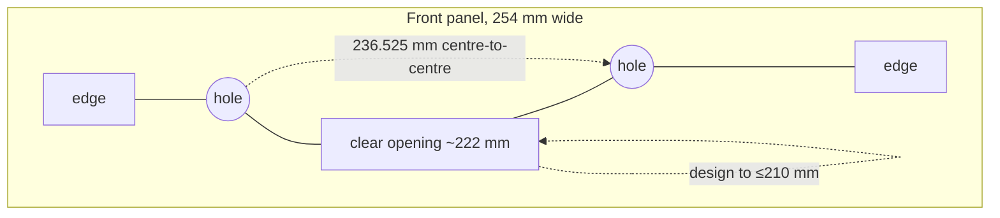

# The 10-inch rack specification

The dimensional reference for this build. Every number used in `rack/params.json` and in
every model traces back to this document.

## Headline: there is no 10-inch standard

There is no published standard for a 10-inch rack. EIA-310, IEC 60297 and DIN 41494 all
define the **482.6 mm (19-inch)** series only. The 10-inch format is a de facto
convention that borrowed exactly one thing from the 19-inch world — the **44.45 mm rack
unit** — and then let each vendor decide the rest for themselves.

This has three consequences that shape the whole design:

1. **Height is trustworthy. Width is a habit.** If you buy or design by height, you are
   on safe ground. If you buy by width, you are trusting a convention.
2. **"Fits any 10-inch rack" is not a testable claim.** No vendor can verify it, because
   there is nothing to verify it against.
3. **The rack we are building is the reference.** Since we control the rails, we define
   the geometry and publish it, rather than hoping to match someone else's.

## The numbers

| Measurement | Value | Notes |
| :--- | :--- | :--- |
| 1U height | **44.45 mm** (1.75") | Inherited from EIA-310. The only universally agreed figure. |
| Usable height, 42U | **1866.9 mm** | 42 × 44.45 |
| Hole positions per U | 3 | Standard 19" pattern. Most 1U parts use the outer two. |
| Vertical hole spacing within a U | 15.88 / 12.70 / 15.88 mm | Top hole → middle → middle → bottom hole. |
| Vertical hole centres, 2-hole 1U part | 31.75 mm | 1st and 3rd hole of the U, middle left free. |
| Nominal panel height, 1U | 43.65 mm | Deliberately 0.8 mm shorter than the U it fills, split top and bottom. |
| **Horizontal hole centres** | **236.525 mm** (9.312") | Centre of left rail hole to centre of right rail hole. **The number that decides fit.** |
| Panel width, nominal | 254 mm (10") | Where the name comes from. Must clear the gap between the rails. |
| Clear opening between rails | ~222 mm | Absolute maximum horizontal clearance. |
| Recommended design envelope | **≤ 210 mm** | What a device or tray should actually fit within, allowing tolerance. |
| Square cage-nut slot | 9.5 × 9.5 mm | On racks that use cage nuts. |
| Depth | **not standardised** | Common cabinets: 200 mm or 260 mm. See [ADR-0003](decisions/0003-rack-depth.md). |
| Overall shell width | vendor-specific | A Four Layers rack measures 264.525 mm; others differ. Nobody is wrong. |

### Derived from the 19-inch offsets

The 10-inch figures are not arbitrary — they are the 19-inch proportions applied at half
width. Wikipedia's 19-inch article gives a 482.6 mm panel, 464.2–465.8 mm hole centres,
and a 450.85 mm rail gap:

- Panel edge → hole centre: **17.5 mm**
- Hole centre → rail edge: **~14.25 mm**

Apply the same offsets to a 254 mm panel and you get **236.5 mm hole centres** and a
**~222 mm opening**. That is why the community numbers check out even without a standard
behind them.

## What to measure on any rack you buy or inherit

If you measure one thing, measure this: a mounting hole on the left rail and the hole
opposite it on the right, at the same height, centre to centre. **You are looking for
236.525 mm.** Within about ±0.5 mm and you are fine. If it lands anywhere else, no
10-inch panel from anyone will fit, and the rack is probably a different format sold in
similar language.

Then write down two more things while the tape is out:

- **The clear space between the rails** — the part has to fall into it.
- **What the hole actually is** — square cage-nut slot, round hole with a threaded
  insert, or a thread cut straight into the rail. This decides your fasteners, not
  whether the part fits. See [ADR-0002](decisions/0002-fastener-and-rail-system.md).

## Fastener options in the wild

| System | Hole | Hardware | Notes |
| :--- | :--- | :--- | :--- |
| Cage nut | 9.5 mm square | M6 or 10-32 cage nut + screw | Forgiving of misalignment; most flexible. |
| Tapped rail | M6 or M5 thread in rail | Screw only | Nothing to lose, but no adjustment. |
| 10-32 / 12-24 | Round | Machine screw | Common on US-market gear. |
| Printed thread | Printed hole | Self-tapping or heat-set insert | Only viable for light loads. |

## Sources

- Project MINI RACK community reference (`geerlingguy/mini-rack`) — 236.525 mm hole
  spacing, ~220 mm absolute clearance, ~210 mm practical envelope, 44.45 mm U height.
- Four Layers, *10 inch rack dimensions: every measurement that matters* (2026-08-31) —
  43.65 mm 1U panel height, 31.75 mm vertical hole centres, 9.5 mm cage-nut slot,
  264.525 mm shell width, and the "no standard exists" framing.
- picklog.cc, *10 Inch Rack Dimensions: 254, 236.5 and 222 mm Explained* (2026-09-03) —
  the three-widths distinction, the 19-inch offset derivation, NavePoint CAD figures
  (253.9 mm overall / 236.4 mm holes / 197.9 mm lip).
- EIA-310 / IEC 60297 / DIN 41494 — the 19-inch series these numbers are derived from.

## Open questions

- [ ] Confirm the printed rail's own hole spacing after the first frame module is
      printed and measured. Printed dimensions drift; the CAD number is a target.
- [ ] Decide whether to support cage nuts or printed threads (ADR-0002).
- [ ] Confirm whether commercial 10" gear will be mixed in, which would force us to
      match 236.525 mm exactly rather than approximately.
