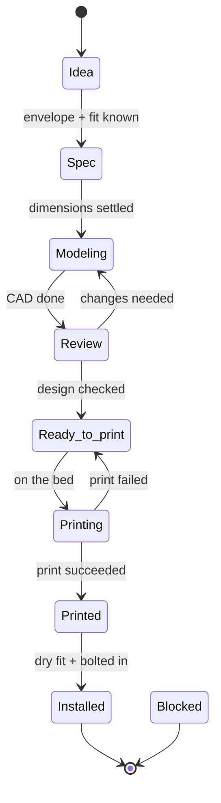

# Project tracking

Everything that has to be designed, printed, bought or decided is a GitHub issue, and
every issue is an item on one Project board. This document is the contract: it defines
the board's fields, its views, and the rules for when an item moves.

## The board

**Project:** `42U 10-Inch Rack` (Project v2, owned by `SamPlaysKeys`)
**Repo:** `SamPlaysKeys/42u-10in-rack`

Create it with:

```bash
gh project create --owner SamPlaysKeys --title "42U 10-Inch Rack"
./scripts/setup_github.sh          # labels
```

Then add the fields and views below by hand — `gh` cannot create Project v2 fields.

## Custom fields

Add these in **Project → Settings → Fields**. The names matter: the workflow rules below
reference them.

| Field | Type | Options / notes |
| :--- | :--- | :--- |
| **Stage** | single select | `Idea`, `Spec'd`, `Modeling`, `Review`, `Ready to print`, `Printing`, `Printed`, `Installed`, `Blocked` |
| **Type** | single select | `Frame`, `Rail`, `Power`, `Shelf`, `Panel`, `Bracket`, `Cable`, `Hardware`, `Docs`, `Tooling` |
| **Module** | single select | `1` … `7`, plus `all` — which of the seven 6U modules this touches |
| **U position** | number | The U row in the rack, 1–42. Empty if not placed. |
| **Material** | single select | `PETG`, `PA-CF`, `ASA`, `PLA`, `Metal`, `None` |
| **Print time (h)** | number | Actual, filled in when printed |
| **Filament (g)** | number | Actual |
| **Qty needed** | number | How many to print |
| **Qty printed** | number | How many exist |
| **Priority** | single select | `P0` (blocking), `P1`, `P2`, `Nice to have` |

`Qty printed` versus `Qty needed` is the field that makes the board useful: an item is
only really done when the two match.

## Views

| View | Layout | Filter / grouping | Answers |
| :--- | :--- | :--- | :--- |
| **Board** | Board | Group by **Stage** | Where is everything right now? |
| **Print queue** | Table | `Stage = Ready to print OR Printing`, sort by Priority | What goes on the printer next? |
| **By type** | Board | Group by **Type** | Which categories are lagging? |
| **Print progress** | Table | `Type` is any print type, columns: Qty needed, Qty printed, Material, Print time | What still has to be printed? |
| **Rack layout** | Table | Sort by **U position** ascending | What is at U23? |
| **Modules** | Board | Group by **Module** | Which of the seven modules is behind? |
| **Roadmap** | Roadmap | Date field: none; group by Stage | The phase view. |

The **Rack layout** view is the one to keep honest. It should always agree with
`rack/layout.md`; if it does not, the file is the source of truth and the field is wrong.

## The item lifecycle



| Transition | Gate — do not move the item until this is true |
| :--- | :--- |
| Idea → Spec'd | The device/envelope it serves is known, including real dimensions. |
| Spec'd → Modeling | Critical dimensions recorded in the part README. |
| Modeling → Review | Source committed, STL exported, README status set to `Draft`. |
| Review → Ready to print | Printability checked: orientation, overhangs, part fits the bed. |
| Ready to print → Printing | Batch created in `models/exports/`. |
| Printing → Printed | Print succeeded **and** has a row in `printing/print-log.md`. |
| Printed → Installed | Dry fit done, measured, README status raised to `Validated`. |

A failed print does not go to `Blocked`. It goes back to `Ready to print` and gets a row
in the failures table, because the fix is usually a setting rather than a redesign.

## Issue conventions

Titles are prefixed so the board is scannable without labels:

| Prefix | For | Example |
| :--- | :--- | :--- |
| `[part]` | A part to design and print | `[part] Frame module, 6U` |
| `[device]` | A device to source and mount | `[device] 8-port 2.5G switch` |
| `[print]` | A batch to print | `[print] Batch 2: first frame module` |
| `[spec]` | A specification question | `[spec] Confirm rail hole spacing` |
| `[doc]` | Documentation | `[doc] Fill in the rack layout` |
| `[buy]` | Purchasing | `[buy] M6 cage nuts and screws` |

Every issue should carry exactly one **Stage**-mirroring label (`stage:*`) and one
`type:*` label, so filtering works in the issue list as well as on the board.

## Working rules

- **One issue, one deliverable.** "Design the shelves" is not an issue; "Universal 1U
  shelf" is.
- **An issue is not done when the model exists.** It is done when the part is printed and
  fitted, unless it is explicitly a design-only item.
- **Link the part.** Every `[part]` issue body names its directory, e.g.
  `models/04-shelves/shelf-universal-1u`, so the issue and the code find each other.
- **The board is generated from the repo, not the other way around.** `inventory/` and
  `models/` are the sources of truth; the board is a view of them. When they disagree,
  the repo wins and the board gets fixed.
- **Close the loop in `rack/layout.md`.** Installing a device is not done until the
  layout map shows it.

## Automation

The inventory validator is designed to run in CI, but GitHub refuses API-created
workflow files: a token without the `workflow` scope cannot write under
`.github/workflows/`. Install `inventory-check.yml` once through the web UI (Actions →
New workflow) or a local clone with a suitably scoped token — the exact file and both
routes are in [`ci-workflow.md`](ci-workflow.md).

Also run `scripts/setup_github.sh` before opening issues, or the `stage:*` filters will
silently match nothing.

A useful extension once the board is running: a workflow that opens an issue
automatically for every inventory entry whose `mount.type` is `bracket` or `tray` and
which has no corresponding directory in `models/07-mounts/`. That keeps the "what still
needs designing" list from drifting away from the device list.
