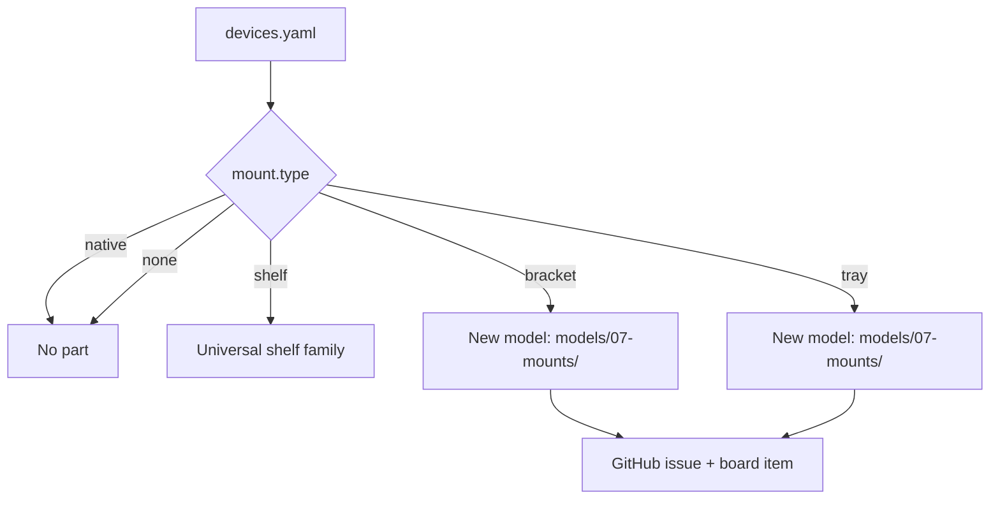

# Inventory

Everything that goes *in* the rack, as data rather than prose. `devices.yaml` is the
machine-readable list; `validate_inventory.py` checks it against the 42U layout.

## Files

| File | What it holds |
| :--- | :--- |
| `devices.yaml` | Every device: dimensions, weight, U height, power, mounting plan, status. |
| `consumables.md` | Screws, cage nuts, inserts, cable, fans — the stuff that is not a device. |

## Why YAML

Because the inventory drives the work. Each entry's `mount.type` decides whether a
printed part is needed and what kind, so the list of parts to design can be generated
from the list of devices rather than guessed at:

- `native` — the device has rack ears and bolts straight to the rails. No part needed.
- `shelf` — needs a flat shelf. Reuses the universal shelf family.
- `bracket` — needs a device-specific printed bracket. **One model per entry.**
- `tray` — needs a captive tray that slides, e.g. for a device with a hidden power button.
- `none` — sits on the rack floor or a shelf already allocated.



## Required fields

Every device needs: `id`, `name`, `category`, `u_height`, `width_mm`, `depth_mm`,
`height_mm`, `weight_kg`, `mount.type`, `status`.

`u_position` may be `null` while a device is only planned — that is the point of the
file existing before the rack does. Once it is set, it is checked for collisions.

## Status vocabulary

| Status | Meaning |
| :--- | :--- |
| `planned` | Wanted, not owned. |
| `owned` | In hand, not in the rack. |
| `installed` | In the rack and working. |
| `retired` | Removed; keep the row for history. |

## Keeping it honest

```bash
python3 scripts/validate_inventory.py
```

Run it before every commit that touches the inventory. It checks required fields, U
range, U collisions, physical fit against the 210 mm design envelope, and that the
generated allocation table matches `rack/layout.md`. CI runs it on every push.
